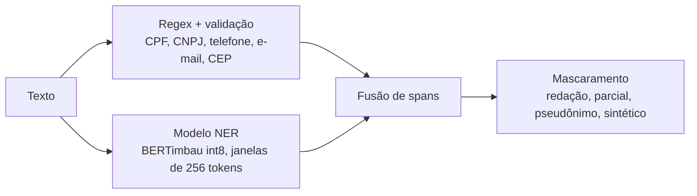

<p align="center">
  <picture>
    <source media="(prefers-color-scheme: dark)" srcset="docs/assets/logo-dark.png">
    
  </picture>
</p>

# PII-BR

Detecção e mascaramento de dados pessoais (PII) em textos em português do Brasil, para quem precisa anonimizar logs, tickets, e-mails e documentos sob a LGPD.

Ferramentas como o Presidio vão bem em inglês, mas não têm reconhecedores para CPF, CNPJ, RG ou CEP. O PII-BR combina um modelo NER treinado em português com regras determinísticas que validam dígito verificador, DDD e CEP, e inclui o **CNPJ alfanumérico** emitido desde julho de 2026.

| Peça | Onde |
| --- | --- |
| Demo (Space) | [huggingface.co/spaces/brennocm/PII-BR](https://huggingface.co/spaces/brennocm/PII-BR) |
| Modelo | [huggingface.co/brennocm/PII-BR](https://huggingface.co/brennocm/PII-BR) |
| Dataset | [huggingface.co/datasets/brennocm/PII-BR](https://huggingface.co/datasets/brennocm/PII-BR) |
| Código | este repositório |

## Entidades

| Entidade | Exemplo | Detecção |
| --- | --- | --- |
| `NOME` | Maria Aparecida Souza | Modelo |
| `CPF` | 123.456.789-09 | Regex + dígito verificador + modelo |
| `CNPJ` | 12.ABC.345/01DE-35 | Regex + dígito verificador (numérico e alfanumérico) + modelo |
| `RG` | 12.345.678-9 | Modelo + contexto |
| `TELEFONE` | (11) 98765-4321 | Regex + DDD válido + modelo |
| `EMAIL` | maria.souza@example.com | Regex |
| `ENDERECO` | Rua das Flores, 123, ap. 42 | Modelo |
| `CEP` | 01310-100 | Regex + contexto |
| `DATA_NASC` | nascida em 03/07/1990 | Modelo |

Documento com formato certo e dígito errado vira alerta de "possível documento inválido" e é mascarado mesmo assim, porque pode ser um documento real digitado com erro.

## Uso

```bash
pip install "pii-br[model] @ git+https://github.com/brennocm/PII-BR"
```

```python
from pii_br import Detector, Masker
from pii_br.model import NerModel

detector = Detector(NerModel("brennocm/PII-BR"))  # sem modelo, Detector() usa só as regras
texto = "Sou Ana Lima, CPF 123.456.789-09, whats (11) 98765-4321."
spans = detector.detect(texto)

masker = Masker()  # um sal secreto por sessão
masker.mask(texto, spans, "redact")  # Sou [NOME], CPF [CPF], whats [TELEFONE].
masker.mask(texto, spans, "partial")  # Sou [NOME], CPF ***.456.789-**, whats (**) *****-4321.
masker.mask(texto, spans, "pseudonym")  # Sou <NOME_1>, CPF <CPF_1>, whats <TELEFONE_1>.
masker.mask(texto, spans, "synthetic")  # Sou Gabriela Reis, CPF 609.746.327-83, ...
```

O valor sintético é aleatório e passa na validação, então pode coincidir com o documento ou o telefone de uma pessoa real. Use-o para dados de teste, nunca para publicar como se fosse fictício garantido; para isso, prefira `redact` ou `pseudonym`.

O núcleo (`pii_br`) só usa a biblioteca padrão; o modelo é o extra opcional `[model]`.

## Como funciona



- **Limiar:** a confiança mínima vale só para o modelo e é aplicada antes da fusão, para que um palpite fraco nunca apague um achado da regex.
- **Fusão:** CPF/CNPJ com dígito válido vence; o modelo vence em nome, endereço e RG; no empate fica o span maior. Quando regex e modelo concordam, o span sai com fonte `ambos`.
- **Pseudônimo:** HMAC-SHA256 com sal secreto por sessão. Um hash sem sal seria reversível, porque o espaço de CPFs é pequeno o bastante para força bruta.
- **Dataset:** 38 mil frases sintéticas em 8 domínios (atendimento, WhatsApp, e-mail, contrato, cadastro, ticket, log, boletim de ocorrência), anotadas por construção, mais ~200 frases escritas à mão para o `test_real`.

## Resultados

Métrica por span, critério de sobreposição, no `test_real` (frases escritas à mão, fora dos templates do treino). Os números por entidade e por split estão no [model card](https://huggingface.co/brennocm/PII-BR).

| Sistema | Precisão | Recall | F1 |
| --- | --- | --- | --- |
| **Híbrido (modelo int8 + regex)** | 0,939 | 0,990 | **0,964** |
| Só o modelo (int8) | 0,928 | 0,955 | 0,941 |
| Só o modelo (fp32) | 0,928 | 0,960 | 0,944 |
| Só regex (este pacote, sem modelo) | 0,989 | 0,450 | 0,619 |
| Presidio (recognizers padrão, spaCy pt) | 0,595 | 0,604 | 0,600 |

A regex acerta 97–100% de CPF, CNPJ, telefone, e-mail e CEP, mas não vê nomes, endereços nem datas. O Presidio vê nomes e endereços, mas tem 0% em CPF, CNPJ e CEP. O pipeline híbrido existe para cobrir as duas metades.

## Desenvolvimento

Requer [mise](https://mise.jdx.dev) e [uv](https://docs.astral.sh/uv/).

```bash
mise install && mise run setup                   # dependências + hook de pre-commit
mise run dev                                     # app Gradio em http://127.0.0.1:7860
mise run web                                     # demo do Space em http://127.0.0.1:8000
mise run check                                   # formato, lint, pyright estrito, testes
uv run python -m data_gen.generate --out data    # gera o dataset (reprodutível por seed)
```

| Pasta | Conteúdo |
| --- | --- |
| `src/pii_br/` | Pacote: validadores, recognizers, fusão, mascaramento, modelo |
| `data_gen/` | Templates, gerador do dataset, `test_real` e publicação no Hub |
| `training/` | Notebook de treino (Kaggle/Colab), avaliação com baselines, model card |
| `space/` | Demo do Space: página estática que roda o pacote (Pyodide) e o modelo (ONNX) no navegador |
| `app/` | App Gradio local, com upload de `.txt` e `.csv` |
| `docs/` | Decisões (ADRs) e o passo a passo de publicação |

O notebook `training/train.ipynb` treina em GPU gratuita do Kaggle em cerca de 30 minutos. Para testar o código em CPU: `SMOKE=1 LOCAL_DATA=$PWD/data uv run --group train jupyter nbconvert --execute training/train.ipynb --to notebook --output-dir outputs/smoke`.

## Limitações

- O modelo é treinado só com dados sintéticos; o `test_real` mede a distância para texto real, mas é pequeno.
- Não cobre dados sensíveis do art. 5º, II da LGPD (saúde, religião, orientação sexual), placas, cartões, PIS ou CNH.
- **Não certifica anonimização.** Pela LGPD (art. 12), dado anonimizado é o que não pode ser revertido por meios razoáveis; mascarar entidades não remove quasi-identificadores. Use como redutor de risco.

## Licença

Código Apache-2.0, dataset CC-BY-4.0, modelo MIT (a licença do BERTimbau).
