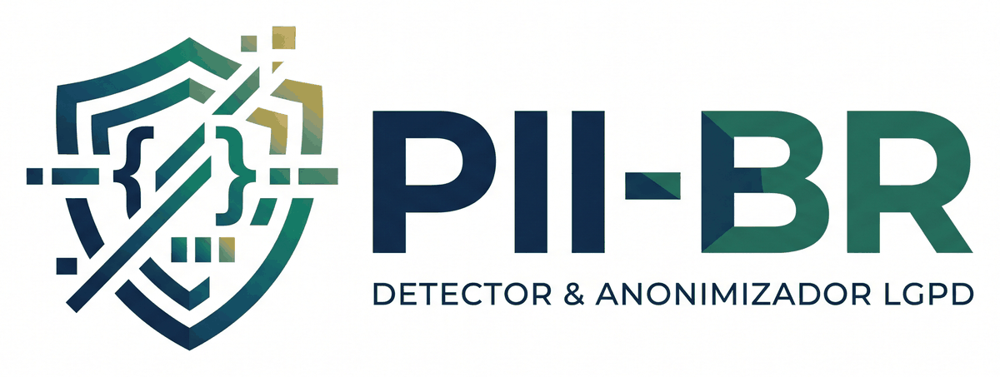

<p align="center">
  
</p>

# pii-br

Detecção e mascaramento de dados pessoais (PII) em textos em português do Brasil, pensado para quem precisa anonimizar logs, tickets e documentos sob a LGPD.

Ferramentas como o Presidio vão bem em inglês, mas não reconhecem CPF, CNPJ, RG ou CEP. Este projeto combina validação determinística (dígito verificador, DDD, faixa de CEP) com um modelo NER treinado em português.

> **Status:** fase 1 de 5. O pacote de validadores e recognizers está pronto; dataset, modelo e demo vêm a seguir. Plano completo em [SPEC.md](SPEC.md).

## O que já funciona

```python
from pii_br import recognize

texto = "Sou Ana, CPF 123.456.789-09, CNPJ 12.ABC.345/01DE-35, whats (11) 98765-4321."
for span in recognize(texto):
    print(span.label, span.text, span.valid)
# CPF 123.456.789-09 True
# CNPJ 12.ABC.345/01DE-35 True
# TELEFONE (11) 98765-4321 True
```

- **CPF e CNPJ** com e sem pontuação, incluindo o **CNPJ alfanumérico** emitido desde julho de 2026 (IN RFB nº 2.229/2024).
- Documento com formato certo e dígito errado é retornado com `valid=False`, como alerta, em vez de ser ignorado.
- **Telefone** com DDD validado e números 0800/4004 descartados; **CEP** e **e-mail**.
- Números corridos de 11 dígitos (CPF ou celular?) são decididos pela palavra de contexto mais próxima.
- Validadores conferidos contra fontes independentes (`validate-docbr`, Faker e o exemplo oficial da Receita) em mais de 1.000 casos por documento.

## Desenvolvimento

Requer [mise](https://mise.jdx.dev) e [uv](https://docs.astral.sh/uv/).

```bash
mise install
uv sync
mise run check      # formato, lint, tipos (pyright estrito) e testes
mise run check:all  # o que o CI roda
```

## Limitações

A ferramenta reduz risco, mas não certifica anonimização. Pela LGPD (art. 12), só é anonimizado o dado que não pode ser revertido por meios razoáveis, e mascarar entidades não remove quasi-identificadores.

## Licença

Apache-2.0.