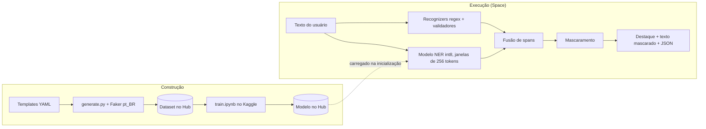

# PII-BR — Detector de PII para LGPD

Nov 23, 2026 · @Brenno · v2 (revisada após análise de viabilidade de hardware)

## Visão geral

O projeto entrega um detector de dados pessoais (PII) em português do Brasil, publicado no Hugging Face como três peças ligadas: dataset, modelo e Space. Tudo roda em camadas gratuitas e pode ser implementado por um agente de código. O humano roda o treino em GPU gratuita (Kaggle/Colab) e revisa os pontos marcados.

**Problema.** Ferramentas de detecção de PII (Presidio, modelos NER públicos) são fortes em inglês e fracas em identificadores brasileiros como CPF, CNPJ, RG e CEP. Quem precisa anonimizar texto para a LGPD (Lei 13.709/2018) acaba escrevendo regex na mão.

**Objetivo.** Um pipeline híbrido que combina um modelo NER treinado em PT-BR com validação determinística de dígito verificador, e uma demo pública que mascara texto colado pelo usuário.

**Público.** Recrutadores e pares de segurança (portfólio), times de dados e DPOs que precisam anonimizar logs, tickets e documentos.

**Entregáveis**

| Peça | Repositório | Conteúdo |
| --- | --- | --- |
| Dataset | `datasets/<usuario>/pii-br` | Frases sintéticas anotadas em BIO, splits train/val/test/test-hard/test-real, dataset card |
| Modelo | `<usuario>/pii-br` | NER fine-tuned, model card com métricas por entidade |
| Space | `spaces/<usuario>/pii-br` | App Gradio em CPU gratuita: detecta, destaca e mascara |
| Código | GitHub `<usuario>/pii-br` | Gerador, treino, avaliação, app e validadores, com testes |

## Viabilidade no hardware atual

Medido em 23/11/2026 na máquina de desenvolvimento: Intel i5-1135G7 (WSL2 limitado a 4 threads, 2 núcleos físicos vistos pelo PyTorch), 16 GB de RAM, sem GPU CUDA, AVX-512 VNNI disponível, 865 GB livres. Benchmark com `neuralmind/bert-base-portuguese-cased`, 19 rótulos, PyTorch CPU.

| Medida | Resultado | Consequência |
| --- | --- | --- |
| Treino, batch 16, 64 tokens | 7,7 s/passo | 30k frases × 4 épocas = 7.500 passos ≈ **16 h**. Inviável localmente; o treino fica no Kaggle/Colab |
| Treino, batch 16, 96 tokens | 9,1 s/passo | Idem |
| Inferência, 1.000 caracteres (407 tokens), fp32 | 0,82 s | 1.000 caracteres passa de 256 tokens: janelamento é obrigatório, não só para "textos longos" |
| Inferência, mesmo texto, int8 dinâmico, 2 threads | 0,32 s | int8 vira padrão no Space, não plano B (conferir se a perda de F1 é < 0,5 ponto) |
| Avaliação em lote, 64 tokens | ≈ 11 frases/s | test + test-hard (5k frases) ≈ 8 min localmente; avaliação local é viável |

**Divisão de trabalho por ambiente**

| Ambiente | O que roda |
| --- | --- |
| Local (WSL2, CPU) | Todo o código, testes, geração do dataset, smoke test de treino (≈ 200 frases, 1 época, alguns minutos), avaliação, baselines, Space em modo dev |
| Kaggle (T4/P100, 30 h/semana grátis) ou Colab | Treino completo. Estimativa: 15 a 30 min por modelo com fp16 na T4 |
| HF Space CPU basic (2 vCPU, 16 GB) | Só inferência. Latência esperada < 1 s com int8 para 1.000 caracteres |

**Plano B sem GPU:** treino local reduzido (10k frases, 2 épocas, `max_length=128`, ≈ 3 h durante a noite) ou troca para um modelo menor (DistilBERT multilíngue ou BERTimbau-base com camadas congeladas). Só usar se Kaggle e Colab estiverem indisponíveis; o model card registra a configuração.

**Ambiente Python.** O sistema tem Python 3.12; o projeto fixa 3.11 via `uv` (`.python-version`) para casar com Kaggle e o Space. Torch local vem do índice CPU do PyTorch, para não baixar CUDA à toa.

## Escopo

O MVP cobre 9 entidades. Os identificadores de formato fixo são detectados pelo validador determinístico, os de texto livre pelo modelo. Todos são anotados no dataset, para que o modelo também aprenda os formatos e sirva de rede de segurança quando a regex falha (formato quebrado, espaços, erro de digitação).

| Entidade | Exemplo | Detecção principal | Validação |
| --- | --- | --- | --- |
| `NOME` | Maria Aparecida Souza | Modelo | — |
| `CPF` | 123.456.789-09 | Regex + modelo | Dígito verificador (módulo 11) |
| `CNPJ` | 12.345.678/0001-95 · 12.ABC.345/01DE-35 | Regex + modelo | Dígito verificador, numérico e alfanumérico |
| `RG` | 12.345.678-9 | Modelo + contexto | Sem validação universal (varia por estado) |
| `TELEFONE` | (11) 98765-4321 | Regex + modelo | DDD válido (lista Anatel), 8 dígitos fixo ou 9 dígitos começando com 9 |
| `EMAIL` | maria.souza@example.com | Regex | Sintaxe |
| `ENDERECO` | Rua das Flores, 123, ap. 42 | Modelo | — |
| `CEP` | 01310-100 | Regex + contexto | Formato; sem hífen só com palavra de contexto ("CEP", "cep:") |
| `DATA_NASC` | nascida em 03/07/1990 | Modelo (depende do contexto) | Data válida e no passado |

Telefones 0800/0300/4004 são de empresas, não de pessoas: entram como negativos (`O`).

**Fase 2 (opcional):** placa de veículo (Mercosul e antiga), cartão de crédito (Luhn), PIS/PASEP, CNH, título de eleitor, chave Pix aleatória.

**Fora do escopo**

- Dados pessoais sensíveis do art. 5º, II (saúde, religião, orientação sexual): exigem classificação semântica, não NER de formato.
- OCR de imagens e PDFs escaneados.
- Qualquer garantia de conformidade legal: a ferramenta reduz risco, não certifica anonimização.

## Arquitetura

A construção roda uma vez (gerar dados, treinar, publicar). O Space só carrega o modelo pronto e o combina com regras determinísticas a cada requisição.



As duas detecções rodam sobre o mesmo texto; a fusão decide o span final e o mascaramento aplica a estratégia escolhida pelo usuário.

## Componente 1 — Dataset sintético

O dataset é gerado por templates preenchidos com Faker `pt_BR`, anotado em BIO por construção (sem anotação manual) e dividido por template para evitar vazamento.

**Geração**

1. Templates com slots, escritos pelo agente, em 8 domínios: atendimento ao cliente, chat estilo WhatsApp, e-mail corporativo, contrato, cadastro/formulário, ticket de suporte, log de aplicação, boletim/ocorrência. Meta: pelo menos 400 templates, com pelo menos 40 por domínio.
   - Exemplo: `Oi, sou {NOME}, meu CPF é {CPF} e moro na {ENDERECO}, CEP {CEP}.`
2. Slots preenchidos pelo Faker (`name`, `cpf`, `cnpj`, `rg`, `phone_number`, `email`, `street_address`, `postcode`, `date_of_birth`) e por geradores próprios onde o Faker não basta:
   - **CNPJ alfanumérico:** o Faker só gera CNPJ numérico. Gerador próprio em `pii_br.validators` (o mesmo código do validador, testado contra exemplos oficiais), com cerca de 30% dos CNPJs no formato novo.
   - **Telefone:** gerador próprio a partir da lista de DDDs, porque o Faker mistura números 0800/0300 e formatos que não ocorrem.
   - **Nomes:** Faker complementado por listas abertas (por exemplo, frequência de nomes do Censo IBGE) para reduzir viés regional e de gênero.
3. Variantes de formato por entidade: CPF com e sem pontuação, telefone com e sem DDD, +55, espaços, e-mail em maiúsculas, CNPJ alfanumérico em minúsculas.
4. Ruído realista em parte das frases (≈ 30%): erros de digitação, falta de acento, caixa baixa, emojis, quebras de linha. O ruído é aplicado **antes** de registrar os offsets, ou os offsets são recalculados depois; nunca se aplica ruído ao texto pronto sem reajustar os spans. Ruído dentro de entidade de formato fixo (CPF, CNPJ) é limitado a separadores (espaço, ponto faltando), para que o rótulo continue correto.
5. Negativos difíceis, rotulados `O`: números de pedido, protocolos e códigos de barras com 11 ou 14 dígitos **sem formato de CPF/CNPJ e sem palavra de contexto**, telefones 0800, nomes de empresas e ruas famosas fora de contexto pessoal ("a Av. Paulista estava parada").
6. **CPF/CNPJ com dígito verificador errado são rotulados como `CPF`/`CNPJ`, não como `O`.** O modelo aprende formato e contexto; quem decide a validade é o validador determinístico, que emite o alerta "possível documento inválido". (A v1 os marcava como `O`, o que ensinava o modelo a deixar passar exatamente os casos que o pipeline quer mascarar, como um CPF real digitado com erro.) Cerca de 10% dos CPFs/CNPJs saem com dígito inválido.
7. Cerca de 15% das frases sem nenhuma PII.

**Tokenização e rótulos.** O gerador registra o offset de cada span ao preencher o slot e tokeniza por palavras com uma regra fixa, documentada no card: separa por espaço e destaca pontuação de borda (`,` `.` `:` `;` `!` `?` `(` `)` no início ou fim da palavra), mas mantém pontuação interna (`123.456.789-09`, `maria.souza@example.com`, `(11)` fica como token próprio). Um teste garante que todo limite de span cai num limite de token. A saída tem `tokens` e `ner_tags` (BIO, 19 rótulos: `O` + B/I das 9 entidades) e os spans em caracteres, para avaliação independente de tokenizador.

**Splits**

| Split | Frases | Regra |
| --- | --- | --- |
| train | 30.000 | 80% dos templates |
| validation | 3.000 | mesmos templates do train, valores novos |
| test | 3.000 | mesmos templates, valores novos |
| test-hard | 2.000 | 20% dos templates, nunca vistos no treino, estratificados por domínio |
| test-real | \~200 | frases fora do sistema de templates; o agente rascunha em estilos variados, o humano revisa, corrige e reescreve parte delas |

O sorteio dos templates para o test-hard usa a mesma seed e é salvo em `data_gen/split_templates.json`, para auditoria.

**Esquema de cada linha:** `id`, `text`, `tokens`, `ner_tags`, `spans` (lista de `{start, end, label}`), `domain`, `template_id`, `noisy` (bool), `has_invalid_dv` (bool).

**Dataset card.** Motivação, processo de geração, regra de tokenização, distribuição de rótulos por split, limitações (viés dos nomes, frases menos naturais que texto real), aviso de que nenhum dado é de pessoa real, licença CC-BY-4.0, seed fixa e versão do Faker para reprodutibilidade.

## Componente 2 — Modelo NER

O modelo base é o BERTimbau base, treinado como token classification com o `Trainer` do `transformers`, em GPU gratuita do Kaggle ou do Colab.

**Modelo base**

| Opção | Checkpoint | Licença | Por que |
| --- | --- | --- | --- |
| Principal | `neuralmind/bert-base-portuguese-cased` | MIT | Pré-treinado em PT-BR, tamanho base, roda bem em CPU (medido: 0,3 s com int8) |
| Alternativa | `microsoft/mdeberta-v3-base` | MIT | Multilíngue, costuma ir bem em NER; comparar no `test-hard`. Treinar em fp32 ou bf16: em fp16 o DeBERTa-v3 tende a gerar loss NaN, e a T4 não tem bf16 |

Conferir a licença no Hub antes de publicar o modelo derivado.

**Treino**

- Alinhamento de rótulos: o rótulo vai no primeiro subtoken de cada palavra, os demais recebem `-100`.
- Hiperparâmetros iniciais: `lr=5e-5`, `epochs=4`, `batch=16`, `max_length=256`, `warmup_ratio=0.1`, `weight_decay=0.01`, `fp16=True` só quando houver GPU CUDA (o notebook detecta), seed fixa.
- Padding dinâmico (`DataCollatorForTokenClassification`) e `group_by_length=True`: as frases têm em média menos de 64 tokens, e padding até 256 multiplicaria o custo.
- Melhor checkpoint escolhido pelo F1 de entidade na validação, com early stopping (paciência 2 avaliações).
- Notebook único `train.ipynb` que baixa o dataset do Hub, treina, avalia e faz `push_to_hub` do modelo, com `HF_TOKEN` vindo dos *secrets* do Kaggle/Colab.
- Antes de ir para a GPU, o agente roda o notebook localmente em modo smoke (`SMOKE=1`: 200 frases, 1 época, CPU), para que o humano não perca a sessão de GPU com erro de código.

**Avaliação**

O modelo e o pipeline são avaliados de formas diferentes, porque o pipeline não produz tags BIO.

- **Modelo isolado:** F1 por entidade com `seqeval`, modo estrito, nos splits test, test-hard e test-real.
- **Pipeline híbrido e baselines:** comparação de spans em caracteres contra os `spans` de referência, com dois critérios: casamento exato (mesmo início, fim e rótulo) e sobreposição (para o mascaramento, cobrir o valor importa mais que acertar a borda).
- Recall por entidade em destaque: em privacidade, deixar passar um CPF custa mais que mascarar demais.
- Baselines:
  - **Só regex:** os recognizers de `pii_br` sem o modelo.
  - **Presidio:** `presidio-analyzer` com NLP engine spaCy `pt_core_news_lg` e os recognizers padrão registrados para `pt` (por padrão eles só atendem `en`). Mapeamento de rótulos documentado (`PERSON`→`NOME`, `EMAIL_ADDRESS`→`EMAIL`, `PHONE_NUMBER`→`TELEFONE`, `LOCATION`→`ENDERECO`); entidades sem equivalente contam como não detectadas. A configuração vai no card, para que a comparação seja reproduzível e justa.
- Tabela de erros com exemplos (falsos negativos primeiro) publicada no model card.
- Medir a perda de F1 da quantização int8 no test-hard e reportar no card.

**Model card.** Uso pretendido, entidades, métricas por split e baseline, efeito do int8, limitações (treino só em dados sintéticos), exemplo de uso com `pipeline("token-classification", aggregation_strategy="first", stride=64)`, link para dataset e Space.

## Componente 3 — Space (demo)

O Space é um app Gradio em CPU gratuita: o usuário cola um texto, vê as entidades destacadas e recebe a versão mascarada na estratégia escolhida.

**Pipeline híbrido**

1. **Recognizers determinísticos:** regex para CPF, CNPJ (numérico e alfanumérico), e-mail, telefone e CEP, seguidas de validação (dígito verificador, DDD, data). Entrada normalizada antes (NFKC, dígitos de largura total, espaços não separáveis).
2. **Modelo NER:** versão int8 dinâmica, roda sobre o texto inteiro em janelas de 256 tokens com sobreposição de 64 (`stride` do pipeline do `transformers`). Um texto de 1.000 caracteres já tem cerca de 400 tokens, então o janelamento vale para quase todo uso real.
3. **Fusão de spans:** sobreposições resolvidas por prioridade. Regex com dígito válido vence; o modelo vence em `NOME`, `ENDERECO` e `RG`; em empate fica o span maior. Sequências de 11 dígitos sem pontuação que podem ser CPF ou celular com DDD são decididas pela palavra de contexto mais próxima ("CPF", "tel", "whats"); sem contexto, viram `CPF` se o dígito fecha e `TELEFONE` caso contrário.
4. **Confiança:** cada span sai com fonte (`regex`, `modelo`, `ambos`) e score. CPF/CNPJ com formato certo e dígito errado vira alerta "possível documento inválido", mascarado por padrão.

**Dígito verificador**

- CPF: cada dígito verificador é a soma ponderada dos dígitos anteriores (pesos 10→2, depois 11→2), vezes 10, módulo 11; resultado 10 vira 0. Sequências repetidas (111.111.111-11) são inválidas.
- CNPJ: pesos 5,4,3,2,9,8,7,6,5,4,3,2 e depois 6,5,4,3,2,9,8,7,6,5,4,3,2; dígito = 11 − (soma mod 11), e resto menor que 2 vira 0.
- CNPJ alfanumérico (IN RFB nº 2.229/2024, em vigor para novas inscrições desde julho de 2026, portanto já circulando): as 12 primeiras posições aceitam letras maiúsculas e dígitos; cada caractere vale seu código ASCII − 48 (`0`–`9` → 0–9, `A` → 17 … `Z` → 42) e entra no mesmo cálculo com os mesmos pesos. Os 2 dígitos verificadores continuam numéricos. O validador aceita entrada em minúsculas e normaliza. Os testes usam os exemplos publicados pela Receita Federal; o humano confere a regra no texto oficial na fase 1.

**Estratégias de mascaramento**

| Estratégia | Saída para "CPF 123.456.789-09" | Uso |
| --- | --- | --- |
| Redação | `CPF [CPF]` | Padrão, mais seguro |
| Máscara parcial | `CPF ***.456.789-**` | Telas de atendimento |
| Pseudônimo consistente | `CPF <CPF_1>` | O mesmo valor recebe o mesmo rótulo no texto inteiro |
| Substituição sintética | `CPF 987.654.321-00` | Gerar dados de teste realistas (valor válido, preservando o formato do original) |

A máscara parcial é definida por entidade em `masking.py` (CPF mostra os 6 do meio, e-mail mostra a primeira letra e o domínio, telefone mostra os 4 últimos; `NOME` e `ENDERECO` recebem redação).

O pseudônimo usa HMAC-SHA256 com sal gerado por sessão e nunca exibido, para que não dê para reverter por força bruta (o espaço de CPFs é pequeno). O valor é normalizado antes do HMAC (só dígitos para documentos e telefone, minúsculas para e-mail), para que `123.456.789-09` e `12345678909` recebam o mesmo pseudônimo.

**Interface**

- Entrada: caixa de texto e upload de `.txt` ou `.csv` (colunas escolhidas pelo usuário), com limite de 1 MB e 5.000 linhas na demo.
- Controles: estratégia de mascaramento, entidades a considerar, limiar de confiança.
- Saídas: `HighlightedText` com as entidades, texto mascarado com botão de copiar, JSON de spans, download do arquivo processado.
- 6 exemplos prontos em domínios diferentes, incluindo um com CPF inválido, um com CNPJ alfanumérico e um sem PII.
- Aviso fixo: o texto não é armazenado nem logado; não cole dados reais de terceiros em demos públicas.
- Para o aviso ser verdadeiro: `flagging_mode="never"`, `GRADIO_ANALYTICS_ENABLED=False`, nenhum `print`/log do texto de entrada, arquivos temporários de upload apagados após o processamento. Um teste verifica que o app não escreve o texto em log.

**Configuração do Space.** README com front matter (`sdk: gradio`, `python_version: "3.11"`, `app_file: app.py`), modelo baixado do Hub e quantizado uma vez na inicialização. O Space gratuito dorme após 48 h sem acesso; o primeiro acesso leva de 30 s a 1 min.

**Pacote reutilizável.** A lógica fica em `pii_br/` (validadores, recognizers, fusão, mascaramento), importável fora do Space e sem dependência de `torch` no núcleo (o modelo é opcional), com recognizers opcionais no formato do Presidio.

## Estrutura do repositório e stack

Um único repositório no GitHub concentra todo o código; o Space recebe só a pasta `space/` e o pacote.

```text
pii-br/
├── src/pii_br/        # pacote: types.py, validators.py, recognizers.py, merge.py, masking.py, model.py
├── data_gen/
│   ├── templates/       # templates por domínio (YAML)
│   ├── generate.py      # Faker pt_BR → tokens + ner_tags + spans
│   ├── split_templates.json
│   └── push_dataset.py  # splits + push_to_hub + dataset card
├── training/
│   ├── train.ipynb      # roda no Kaggle/Colab; SMOKE=1 roda local em CPU
│   └── evaluate.py      # seqeval + avaliação por span + baselines regex/Presidio
├── space/
│   ├── app.py           # Gradio
│   └── requirements.txt
├── cards/               # README do dataset, do modelo e do Space
├── tests/               # pytest: validadores, fusão, mascaramento, gerador, tokenização
├── pyproject.toml       # uv; extras: [model], [train], [baseline], [space]
└── .github/workflows/   # CI de testes + sync do Space
```

**Stack:** Python 3.11 (via `uv`), `faker`, `datasets`, `transformers`, `torch` (CPU localmente), `seqeval`, `gradio`, `huggingface_hub`, `pytest`; `presidio-analyzer` e `spacy` + `pt_core_news_lg` só no extra `[baseline]` e nos recognizers opcionais.

**Deploy do Space:** GitHub Action que, a cada push na `main` com testes verdes, envia `space/` e uma cópia de `src/pii_br/` ao Space via `huggingface_hub.upload_folder`, usando o secret `HF_TOKEN` (token fine-grained com escrita só no Space). O CI não instala `torch` nos testes do núcleo, para rodar rápido.

## Plano de execução

São 5 fases em sequência; o agente faz quase tudo, e o humano entra em três pontos: tokens e contas, o treino na GPU e a revisão.

| Fase | Entrega | Agente faz (local) | Humano faz |
| --- | --- | --- | --- |
| 1. Base | Pacote `pii_br` com validadores e recognizers | Código + testes (CPFs/CNPJs válidos e inválidos, formatos, casos de borda, exemplos oficiais do CNPJ alfanumérico) | Conferir a regra do CNPJ alfanumérico no texto da Receita |
| 2. Dataset | Dataset `pii-br` no Hub | Templates, gerador, splits, card, script de push, rascunho do `test-real` | Criar conta/token HF; revisar \~100 frases geradas e revisar/reescrever o `test-real` |
| 3. Modelo | Modelo `pii-br` no Hub | Notebook de treino com smoke test local, `evaluate.py`, baselines, model card com os números | Rodar o notebook no Kaggle/Colab com o token nos secrets (≈ 30 min) |
| 4. Space | Space `pii-br` público | `app.py`, fusão, mascaramento, int8, exemplos, Action de deploy, medição de latência | Criar o Space e o secret no GitHub; testar à mão |
| 5. Portfólio | Projeto divulgado | README do GitHub com GIF da demo, rascunho de post para LinkedIn | Publicar e fixar os repositórios no perfil |

Cada fase termina com testes verdes e algo publicado, para que o portfólio tenha valor mesmo se o projeto parar no meio. As fases 1 e 2 e quase toda a 4 rodam inteiras no hardware local; a única dependência de GPU é a execução do notebook na fase 3.

## Critérios de aceite, riscos e ética

O projeto está pronto quando as três peças estão públicas, ligadas entre si e com números honestos, mesmo que abaixo das metas.

**Critérios de aceite**

- [ ] Validadores com 100% de acerto em uma suíte de pelo menos 1.000 CPFs/CNPJs válidos e inválidos, checada contra uma fonte independente do próprio código (exemplos oficiais da Receita e uma biblioteca de terceiros, como `validate-docbr`, para os numéricos). Comparar o validador com o gerador que usa o mesmo código não prova nada.
- [ ] Dataset no Hub com 5 splits, card completo e geração reprodutível por seed (mesmo hash de arquivo em duas execuções).
- [ ] Modelo com F1 ≥ 0,95 no `test` e meta de F1 ≥ 0,85 no `test-hard`; recall de CPF e CNPJ ≥ 0,98 no pipeline híbrido (critério de sobreposição).
- [ ] Pipeline híbrido supera os baselines regex e Presidio no `test-real` em F1 e recall médios.
- [ ] Space responde em menos de 3 s para um texto de 1.000 caracteres em CPU gratuita, medido após o aquecimento (meta interna: < 1 s com int8).
- [ ] Cards cruzados: dataset → modelo → Space → GitHub.

As metas numéricas são pontos de partida; se não forem atingidas, o resultado real vai para o card com a análise de erros. F1 alto no `test` é esperado (mesmos templates) e não é o número que importa: o card destaca `test-hard` e `test-real`.

**Riscos e mitigação**

| Risco | Mitigação |
| --- | --- |
| Modelo decora os templates e falha em texto real | Split por template, ruído, `test-real` fora do sistema de templates |
| Nomes do Faker pouco diversos (viés regional e de gênero) | Listas extras de nomes e sobrenomes de fontes abertas, distribuição documentada no card |
| Sem GPU local (medido: ≈ 16 h para o treino completo em CPU) | Treino no Kaggle/Colab; smoke test local antes; plano B de treino reduzido durante a noite |
| Cota de GPU gratuita esgotada ou sessão interrompida | Checkpoint salvo a cada época no `/kaggle/working` e retomada com `resume_from_checkpoint` |
| Space gratuito dorme e demora no primeiro acesso | Avisar no README; modelo carregado uma vez na inicialização |
| Latência alta em CPU | int8 dinâmico como padrão (medido: 0,3 s local); export ONNX se ainda faltar |
| Regra nova de CNPJ mal implementada | Testes com exemplos oficiais da Receita Federal |
| Spans desalinhados por ruído ou tokenização | Offsets registrados na geração e teste de alinhamento span↔token em todo o dataset |
| Aviso de "não armazenamos" falso por log padrão do Gradio | Flagging e analytics desligados, teste de ausência de log |

**Ética e limitações**

- Nenhum dado real é usado no treino; o card deixa isso explícito.
- A ferramenta não substitui análise jurídica: pela LGPD (art. 12), só é anonimizado o dado que não pode ser revertido por meios razoáveis, e mascarar entidades não garante isso (quasi-identificadores continuam no texto). O resultado é, no máximo, pseudonimização.
- Licenças: código Apache-2.0, dataset CC-BY-4.0, modelo MIT (herda do BERTimbau).
